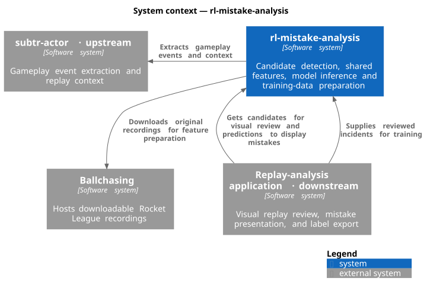
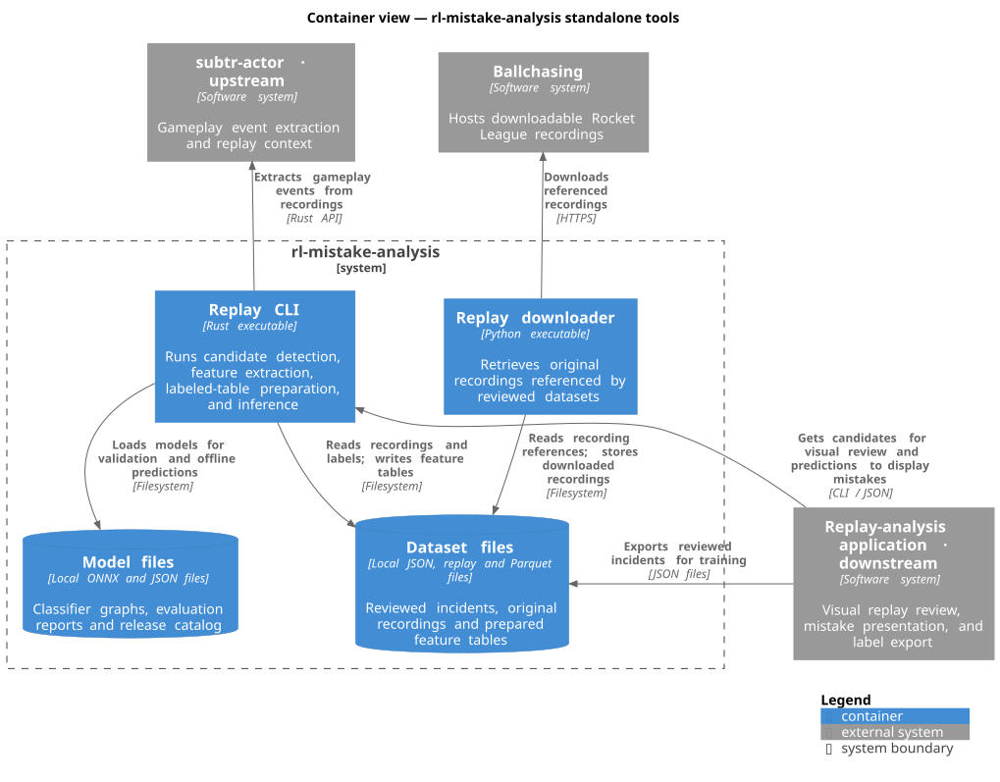

# rl-mistake-analysis

rl-mistake-analysis helps replay-analysis applications identify potential player mistakes in Rocket League and score them with trained models. It also turns human-reviewed incidents into training data, using the same feature calculations that supply the models during inference.

Model releases and evaluation results are available on [Hugging Face](https://huggingface.co/alina-afanaseva/rl-mistake-analysis-models).

A **candidate** is an incident worth reviewing. **Features** are measurements describing that incident. A **model** uses those measurements to estimate whether the incident is a mistake. Each mistake kind defines its candidates and features; different kinds can use different models.

[subtr-actor](https://github.com/rlrml/subtr-actor) supplies gameplay events and replay context. Downstream applications display incidents, collect reviews, and use predictions.

## Implemented mistakes

| Kind | Guide |
| --- | --- |
| `bumping_teammate` | [Teammate bump](docs/mistakes/bumping_teammate.md) |
| `bang_with_time` | [Banging the ball away with time](docs/mistakes/bang_with_time.md) |
| `overcommitting` | [Overcommitting](docs/mistakes/overcommitting.md) |

Each guide defines candidate selection, incident keys, measurement frames, calculations, and extraction commands.

## Architecture

The context view shows this project and the systems it interacts with. Downstream applications obtain candidates for visual review, use models to present mistakes, and export reviewed datasets for training. This project extracts gameplay events through subtr-actor, prepares labeled feature tables, evaluates models, and exports selected models.



The container view shows a CLI integration. A downstream application invokes the Rust CLI to obtain candidates and predictions. The Python feature-table builder requests player-specific features from the CLI and writes unlabeled Parquet tables. The label adapter joins reviewed incidents to their player-specific feature rows. Training tools evaluate configured models, select a winner by cross-validation, and verify exported ONNX probabilities. The downloader retrieves recordings referenced by reviewed datasets. Rust applications can also import the candidate and inference libraries directly.



## Get started

| What you want | Use |
| --- | --- |
| Unlabeled incidents for review | [Candidate library](#get-unlabeled-candidates) |
| Mistake probabilities from a trained model | [Inference library](#score-candidates-with-a-model) |
| Train with your own labels | [Training tools](#training-and-model-releases) |
| Process replay files from the terminal | [Command-line tool](#process-replay-files-from-the-terminal) |

### Get unlabeled candidates

In your Rust application's directory, add the candidate library from GitHub:

```sh
cargo add rl-mistake-analysis-candidates --git https://github.com/assembledev/rl-mistake-analysis.git
```

Cargo fetches and builds the package, recording the source commit in your application's lockfile. Rust 1.92+ is required. You can select a release with `--tag RELEASE_TAG` or a commit with `--rev COMMIT`.

Pass extracted replay events to the library and select a mistake kind:

```rust
use rl_mistake_analysis_candidates::MistakeKind;

let kind = MistakeKind::parse(kind_name)?;
let candidates = kind.candidates(&replay_events)?;
```

`replay_events` contains the supplier's events and recording identity, following [the input contract](docs/formats.md#replay-events). Each candidate identifies the incident and the player being judged and preserves the original event evidence. Labels are supplied by human review.

Overcommitting requires native frames as well as events. Use `kind.candidates_from_analysis(&analysis)` with a combined `ReplayAnalysis`.

### Score candidates with a model

Add the inference library to the same application:

```sh
cargo add rl-mistake-analysis-inference --git https://github.com/assembledev/rl-mistake-analysis.git
```

Install CPU ONNX Runtime 1.24+. Before building, set `ORT_LIB_PATH` to its library directory and `ORT_PREFER_DYNAMIC_LINK=1`. The runtime library must also be available to the operating system's dynamic loader when executing inference.

Download a compatible model release and its `manifest.json` catalog into a local model directory. Extract the candidate measurements using the kind's guide and the frame selection settings recorded in the model contract, then score them:

```rust
use rl_mistake_analysis_inference::Model;

let mut model = Model::load(model_directory, kind_name, model_version)?;
let predictions = model.score_context(candidates, features)?;
```

Load once and reuse the session. Results contain probabilities, threshold decisions, and model identity. Computation runs inside your application through ONNX Runtime. The application controls model downloads, activation, concurrency, and prediction storage.

The manifest's `feature_names` list selects inputs in model order; the extractor can supply additional features.

### Process replay files from the terminal

The CLI is an executable for offline work: extract events from a recording, inspect candidates, prepare training tables from reviews, or test a model. Install it with Cargo using the same ONNX Runtime setup as inference:

```sh
cargo install --locked --git https://github.com/assembledev/rl-mistake-analysis.git rl-mistake-analysis-cli
rl-mistake-analysis --help
```

Extract both analysis events and structured replay data from your own recording:

```sh
mkdir -p artifacts
rl-mistake-analysis extract match.replay > artifacts/match.json
rl-mistake-analysis candidates KIND < artifacts/match.json
```

Each extraction reads one `.replay` file and writes one JSON document. Selected outputs share the recording's checksum and supplier revision and are stored under `outputs`. All selected collectors run in one replay pass. The default selection is `events,replay_data`.

Use `--outputs` to select any combination of the five outputs:

```sh
rl-mistake-analysis extract match.replay --outputs events > artifacts/match.events.json
rl-mistake-analysis extract match.replay --outputs replay_data > artifacts/match.frames.json
rl-mistake-analysis extract match.replay --outputs events,replay_data > artifacts/match.json
rl-mistake-analysis extract match.replay --outputs events,replay_data,stats,stats_timeline,features > artifacts/match.all.json
rl-mistake-analysis outputs
```

All five supplier output forms are implemented using SubtrActor's collectors. `events` includes the analysis timeline and boost tracks; `replay_data` includes structured player and ball frames; `stats` includes accumulated statistics; `stats_timeline` includes full statistics snapshots; `features` includes a numeric matrix with metadata and column headers. The three additional exporters use the supplier's default configurations.

The `events` and `replay-data` commands export their respective payloads individually. Bump and bang candidates accept standalone events or combined exports. Overcommitting and `candidates --all` require combined `events,replay_data` exports. Replace `KIND` with an identifier from the implemented mistakes table, or use `candidates --all` to return every implemented kind.

To score those incidents with an installed model:

```sh
rl-mistake-analysis score MODEL_DIRECTORY KIND VERSION < artifacts/match.json
```

The executable reads files or JSON and writes results. Applications importing the libraries call Rust APIs directly.

## Training and model releases

The shared Python pipeline prepares reviewed feature tables, compares models with replay-grouped validation, tracks experiments, and exports verified ONNX releases. See [Training and model releases](docs/training.md) for the complete workflow.

## Develop and contribute

From this repository's directory:

```sh
nix-shell
```

The shell supplies native tools and activates the Python environment, including notebook dependencies. You can also activate the flake environment explicitly:

```sh
nix develop
uv sync --locked --group notebooks --group training --group tracking --no-install-package scikit-learn --no-install-package pip
source .venv/bin/activate
```

Nix provides the development tools and native ONNX Runtime. With direnv and nix-direnv installed, `direnv allow` activates the environment and `.venv` automatically. Run `jupyter lab` to use notebooks.

Nix is optional. If you prefer another environment, install Rust 1.92+, Python 3.12+, uv, Ruff, Git, and CPU ONNX Runtime 1.24+. Configure the runtime as described above, then synchronize Python dependencies with `uv sync --locked --group notebooks --group training --group tracking`.

Run the same checks as CI:

```sh
cargo fmt --all --check
cargo clippy --locked --all-targets -- -D warnings
cargo test --locked -- --test-threads=1
ruff check .
ruff format --check .
uv run --locked --no-sync pytest
```

Regenerate diagrams with PlantUML and Graphviz installed:

```sh
nix-shell -p plantuml graphviz --run 'plantuml -tsvg -failfast2 docs/architecture/*.puml'
```

Report problems through the repository's issue tracker, including the command and error output.

## License

[MIT](LICENSE).
